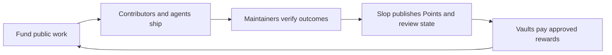

<div align="center">
  
  <h1>slop.cash</h1>
  <p><strong>make money shipping open source</strong></p>
  <p>Pick important work. Run your best coding agent. Ship an accepted result. Build a public record.</p>
  <p>
    <a href="https://slop.cash">Explore projects</a>
    ·
    <a href="https://slop.cash/projects/new">Add a project</a>
    ·
    <a href="https://slop.cash/#leaderboard">View the leaderboard</a>
  </p>
</div>

---

## Product requirements

Read the [canonical Slop PRD](docs/slop-product-requirements.md) before selecting work.
It defines MVP scope, acceptance, and recorded owner decisions.
The repository PRD is authoritative. Google Docs provides a formatted mirror.

## What is Slop?

Slop is a GitHub-native incentive network for open-source work. Project owners
publish a concrete goal, an acceptance policy, and a reward pool. Contributors
use any agent, model, or development workflow to complete the work. Maintainers
accept outcomes in the project’s own repository, and Slop turns that public
history into public Points, review state, and a payment record.

There is no private task marketplace and no platform claim on an issue. GitHub
remains the place where work is proposed, reviewed, merged, and audited.

> Accepted work can earn according to the project’s published pool, scoring
> version, and the owner's monthly allocation. Projections are not wages,
> guarantees, or balances owed.

## How it works

1. **Choose a project.** Review its mission, repository, reward terms, and live
   status at [slop.cash](https://slop.cash).
2. **Copy one prompt.** Give the project skill to the coding agent of your
   choice. Every provider, model, and client is welcome when identified
   exactly.
3. **Ship on GitHub.** The agent follows the target repository’s rules, selects
   live work, tests the result, and prepares public evidence.
4. **Get accepted.** Maintainers decide what merges. Slopbot sizes accepted
   outcomes—not commits, comments, token volume, or busywork.
5. **Build your record.** Leaderboards and contributor profiles show accepted
   work, Points, review state, and verified settlement history.



## Add your open-source project

Sign in with GitHub and create your project at
[`slop.cash/projects/new`](https://slop.cash/projects/new). The form checks your
GitHub authority, creates a paused project, and queues its first security scan.
The setup status shows the next action. Slopbot installation and a clean scan
are required before activation; funding is optional. Owners publish updates
as permanent D1 revisions. Admins handle restrictions and disputes.

Slop generates contributor and reviewer skills from the project revision and
one canonical template. No pull request adds or updates a project.

Project setup records:

- a public GitHub repository and immutable repository identity;
- a verified GitHub steward, without implying legal ownership or capacity;
- a concrete goal and deterministic acceptance criteria;
- repository license facts observed at an immutable commit;
- the maintainer-authored skill fields: scope, contribution guide, supported
  tasks, required tests, review expectations, security contact, closure policy
  and maintainer notes;
- a clearly labeled reward and its project vault, or an external opportunity;
- focused tests for validation, installation, and failure paths.

New projects begin paused. A paused project is registered and listed, but none
of its repositories is collected, so nothing on them reaches the ledger or the
leaderboard. Public contribution access may open independently
when missing authority and terms remain explicit, receipts stay pending, and
payments stay disabled. Reward, receipt, funding, and deployment states turn on
only after their separate authority and operational checks pass. For the full
review checklist, see [CONTRIBUTING.md](CONTRIBUTING.md).

## Points

Slop shows one public measure: Points. Slopbot reviews each accepted pull
request, estimates its size and value, and assigns accepted-work Points. A
maintainer `slop-score` record can correct that assessment. Useful reviews earn
separate credit. Usage evidence is diagnostic and never changes Points, rank,
reward share, or payment. See the [scoring contract](protocol/scoring-v2.md)
and the [Points rules](protocol/points-v1.md).

## What the public record means

Slop uses precise financial states:

- **Projected** — a live estimate based on accepted-work Points.
- **Under review** — the month's private proposal. The owner can change it
  until the cutoff, 72 hours after the month ends. There is no public review.
- **Approved** — the frozen final allocation.
- **Scheduled** — a funded award is reserved in the project vault and waits for
  execution.
- **Paid** — finalized chain evidence reconciles the exact vault transfers.
- **Unclaimed / held / excluded** — visible unresolved states with reasons. A
  funded award without a wallet stays reserved.

The project vault contract is the only funding mode. Anyone may deposit into a
vault; all free funds are refundable only to the project owner's refund
destination. Slop does not create wallets or custody project funds. Its
services hold three narrow kinds of key: the identity attester key, which
co-signs wallet bindings that the contributor's wallet also signs and signs
bounded monthly allocations; one fee-wallet key per network, which only claims
fees into Slop's fee wallet and converts them; and the referral root-posting
key, which posts referral reward roots and moves no tokens. The
[funding guide](funding/README.md) and [AGENTS.md](AGENTS.md) record their
limits and risks. A 2% fee is deducted from each gross award, and the same 2%
fee applies to a withdrawal of unused funds. Legacy Squads and Sablier funding
and its 1% fee are removed; their records stay in git history.

## Repository architecture

The D1 project registry is the only project and repository inventory. Never
hardcode a second list. `bun run projects:sync` snapshots it; generated
registries, pages, raw Markdown endpoints, and downloadable skills derive from
that snapshot. The [repository map](AGENTS.md#repository-map) lists each
directory.

Generated files under `public/downloads/`, `public/projects/`,
`public/protocol/`, and `public/data/cycles/` come from `prepare:site`; do not
edit them by hand.

## Local development

Requirements: Bun 1.3.14 and Node.js 24.15.0 (the CI-tested version).
Installer validation also needs Python 3 with PyYAML 6.0.3. Create an isolated
virtual environment, install `PyYAML==6.0.3`, and set `SLOP_PYTHON` to its Python
executable. Put the tested Node and Bun binaries on `PATH` before running checks.

```bash
bun install --frozen-lockfile
bun run leaderboard:generate
bun run dev
```

Open `http://127.0.0.1:4466`.

To work on the interface without a live ingestion run, sync the registry
snapshot and start Vite directly:

```bash
bun run projects:sync
bun --bun vite --port 4466
```

The dev server then reads the project registry, public direct-payment totals,
and any published snapshot in `/data/` that is not generated locally from
`https://slop.cash`, read-only. Do not commit the synced registry files.

### Local sign-in

Local Vite development starts the local sign-in bridge and API automatically.
`bun run dev` (or Vite directly) keeps sign-in and its return destination on the
local origin. `bun run dev:local` is an alias for the same mode.

Run `bun run dev`, open its local URL, and select "Log in". The existing
Slop GitHub App verifies your identity, then returns you to the local page.
No separate GitHub App or production secret is needed on your machine. A
blocked popup uses the same tab and returns locally. The production identity
service must include the local handoff endpoints before this flow is available.

The backend follows Vite's actual port. Set `SLOP_DEV_ORIGIN` to choose the exact
local origin, or `SLOP_DEV_BACKEND` to use an already managed local backend.
Set `SLOP_DEV_BACKEND=off` for an explicitly read-only preview without local
sign-in. Production builds never enable the local backend.

The backend keeps its data in `.slop-dev/` (ignored by Git; delete it to start
over). Only sign-in and the API run locally, on an empty database. Project and
published data still come from slop.cash, read-only. X connections and payment
networks are not configured. Safari does not accept the session cookie over
`http://localhost`, so use Chrome, Edge, or Firefox. The backend listens on
`127.0.0.1` only and is never deployed.


### Local review checks

Install the lockfile before preparing the ledger input:

```bash
bun install --frozen-lockfile
bun run projects:sync
```

The registry sync reads the public D1 API without credentials, as PR CI does.
Award and skill validation need those project identities; the committed empty
bootstrap registry is not a replacement for the live snapshot. Do not commit
the generated snapshot from local checks.

Choose one ledger preparation path. With live GitHub credentials, collect the
current ledger:

```bash
bun run leaderboard:generate
```

For local pull-request checks without live ingestion, use the same public
snapshot adapter as pull-request CI:

```bash
(
  set -euo pipefail
  ledger_file="$(mktemp)"
  trap 'rm -f "$ledger_file"' EXIT
  curl --fail --silent --show-error \
    --proto '=https' --tlsv1.2 \
    --connect-timeout 10 --max-time 60 --max-filesize 26214400 \
    --output "$ledger_file" https://slop.cash/data/leaderboard.json
  test -s "$ledger_file"
  bun scripts/prepare-pr-ledger.ts "$ledger_file" public/data/leaderboard.json
)
```

The adapter validates the published snapshot and adapts it to the checked-out
schema and registry. It does not collect current GitHub activity or prove live
ingestion. If the chosen preparation fails, stop and resolve the failure before
running checks; do not use a leftover ledger. Do not edit or commit the
generated ledger. Trusted releases collect fresh GitHub data through the
normal release workflow and never use this local adapter.

After the chosen preparation succeeds, run:

```bash
bun run verify
bun run format:check
bun run test:e2e
```

`bun run verify` checks the committed source records (brand tokens, projects,
evaluations, disclosures, contribution quality, cycles, and protocol identity);
audits dependencies; runs type and lint checks, smart-contract unit tests, and
the database, API, CLI and Worker integration suites; and produces the static build.
`bun run format:check` is a separate required check. Browser behavior is covered
by `bun run test:e2e`.

CI selects browser coverage from the changed files: preview and Pages for UI,
registry for API changes, and a short smoke pass for documentation and release
promotion. Installer and isolated-sandbox checks run when their sources change.
The fast type, lint, unit, integration and build gates remain in place.

Contract PRs run the affected chain's build and contract checks. The full escrow
workflow, including validator lifecycles and wallet-browser recovery, runs nightly
and through Actions → **Escrow accounting and recovery** → **Run workflow**.
A development-to-main promotion does not repeat the full development matrix.
Use **slop.cash → Run workflow** to request all browser lanes explicitly.

## Trust and deployment

GitHub is the write-master for project work and policy. Cloudflare Pages serves
the tested static build at [slop.cash](https://slop.cash) and
[slop.tech](https://slop.tech). Production deploys only from the exact tested
`main` commit through the protected GitHub Actions environment. A merge is
not proof of deployment; release evidence must match the deployed bytes, DNS,
TLS, and security headers.

The skill installer authenticates source against GitHub, verifies every
canonical file, activates immutable versions atomically, and preserves the
previous verified version for explicit rollback. Checksums detect corruption;
they do not replace source authorization.

## Contributing

Start with [CONTRIBUTING.md](CONTRIBUTING.md). This repository has a $1,000
monthly Slop contributor pool. Accepted work is reproduced bugs, security,
verification, vault, settlement, and scoring correctness, and measured
improvements inside the approved MVP. UI changes are not accepted unless they
fix a broken user flow. Prove the result with real LLM calls where a model is
involved, and test the workflow in the agent clients that use it. Only owners
and maintainers open issues; fix and prove a defect in a pull request.
Security-sensitive reports go through the project’s private Slop reporting
page. Sign in, submit the report, and follow its screening and review status in
Inbox. Slop handles optional authorized private GitHub forwarding. Never publish
secrets, private traces, prompts, credentials, private keys, or vulnerability
details in an issue or pull request. See the [private reporting rollout](docs/security/private-reporting-rollout.md).

Slop is experimental software. The repository is licensed under the
[MIT License](LICENSE).

### Focused maintenance commands

`bun run prepare:publication` runs site packaging, points generation and profile
publication in order. Development and production builds use this same entrypoint.
Offline profile builds read `data/profiles/seed.json`. To use a captured census,
set `SLOP_PROFILES_INPUT` to its path. Trusted CI sets that path to the live census
it generated earlier. A missing declared input stops publication; leftover public
files never select the source.

`bun run verify:contracts` and `bun run verify:code` are shared by local verification
and CI. The former checks source records; the latter checks types, lint and
the local integration suites. Live chain verification and browser checks remain
separate.

Edit shared contributor and reviewer rules in the canonical generic
project-skill templates. The contributor template's `scripts/` directory is the
single source for its runtime and installer authority; no synchronization step
or mirrored script directory is needed. Project skills are generated from those
templates and each project's D1 revision; never commit a per-project skill copy.
Project-specific instructions live in the D1 revision.

Browser evidence is retained separately under `test-results/preview` and
`test-results/pages`, with matching `playwright-report/` subdirectories. CI keeps
successful screenshots and results as well as failure diagnostics. Tests use
finite per-case budgets. `bun run verify` remains the complete local source gate;
run `bun run test:e2e` separately for the full browser matrix.

## Release environments

`development` serves [staging](https://staging.slop.cash), including an isolated
login and write backend. `main` serves [production](https://slop.cash). See
[release environments](docs/release-environments.md) for setup, promotion, and
acceptance requirements.

## Project vault payouts

The project vault contracts are deployed on Base, Ethereum, Robinhood Chain and
Solana mainnet ([deployment record](contracts/DEPLOY-MAINNET.md)). A deployment
is not a project activation; each project still needs its own reviewed
activation. Projects select one chain and one asset. A gross 100-USDC award
pays 98 to the contributor and 2 in fees. Unused vault withdrawals incur 2% and
go only to the owner's refund destination, while funded unpaid awards remain
reserved until their recipients register a wallet. GitHub remains the only
login. See [the canonical PRD](docs/slop-product-requirements.md) for the
authority model, acceptance tests and deployment gates.
