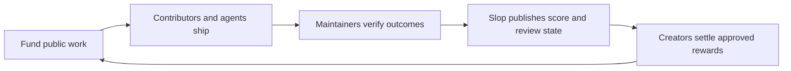

<div align="center">
  
  <h1>slop.cash</h1>
  <p><strong>make money shipping open source</strong></p>
  <p>Pick important work. Run your best coding agent. Ship an accepted result. Build a public record.</p>
  <p>
    <a href="https://slop.cash">Explore projects</a>
    ·
    <a href="https://slop.cash/projects/new">Add a project</a>
    ·
    <a href="https://slop.cash/#leaderboard">View the leaderboard</a>
  </p>
</div>

---

## Product requirements

Read the [canonical Slop PRD](docs/slop-product-requirements.md) before selecting work.
It includes MVP delivery, acceptance, open decisions, and issue coverage.
The repository PRD is authoritative. Google Docs provides a formatted mirror.

## What is Slop?

Slop is a GitHub-native incentive network for open-source work. Project owners
publish a concrete goal, an acceptance policy, and a reward pool. Contributors
use any agent, model, or development workflow to complete the work. Maintainers
accept outcomes in the project’s own repository, and Slop turns that public
history into a transparent score, review process, and payment record.

There is no private task marketplace and no platform claim on an issue. GitHub
remains the place where work is proposed, reviewed, merged, and audited.

> Accepted work can earn according to the project’s published pool, scoring
> version, review process, and final creator approval. Projections are not
> wages, guarantees, or balances owed.

## How it works

1. **Choose a project.** Review its mission, repository, reward terms, and live
   status at [slop.cash](https://slop.cash).
2. **Copy one prompt.** Give the project skill to the coding agent of your
   choice. Every provider, model, and client is welcome when identified
   exactly.
3. **Ship on GitHub.** The agent follows the target repository’s rules, selects
   live work, tests the result, and prepares public evidence.
4. **Get accepted.** Maintainers decide what merges. Slop scores accepted
   outcomes—not commits, comments, token volume, or busywork.
5. **Build your record.** Leaderboards and contributor profiles show accepted
   work, score, review state, and verified settlement history.



## Add your open-source project

Sign in with GitHub and create your project at
[`slop.cash/projects/new`](https://slop.cash/projects/new). The form checks your
GitHub authority, creates a paused project, and queues its first security scan.
The setup status shows the next action. Slopbot installation and a clean scan
are required before activation; funding is optional. Owners publish updates
as permanent D1 revisions. Admins handle restrictions and disputes.

Slop generates contributor and reviewer skills from the project revision and
one canonical template. No pull request adds or updates a project.

Project setup records:

- a public GitHub repository and immutable repository identity;
- a verified GitHub steward, without implying legal ownership or capacity;
- a concrete goal and deterministic acceptance criteria;
- repository license facts observed at an immutable commit;
- the maintainer-authored skill fields: scope, contribution guide, supported
  tasks, required tests, review expectations, security contact, closure policy
  and maintainer notes;
- a clearly labeled reward and its project vault, or an external opportunity;
- focused tests for validation, installation, and failure paths.

New projects begin paused. A paused project is registered and listed, but none
of its repositories is collected, so nothing on them reaches the ledger or the
leaderboard. Public contribution access may open independently
when missing authority and terms remain explicit, receipts stay pending, and
payments stay disabled. Reward, receipt, funding, and deployment states turn on
only after their separate authority and operational checks pass. For the full
review checklist, see [CONTRIBUTING.md](CONTRIBUTING.md).

## Score v2

Accepted work from August 2026 uses integer-thirds effort tiers instead of
account caps or diminishing merge credit. Claude review agents propose effort,
complexity, impact, review load, and logical work-unit grouping; maintainers
ratify the score in an immutable exact-head GitHub record. A valid finalized
private trace receives a fixed evidence bonus. Usage remains diagnostic and
never changes score, rank, reward share, or payment. See
[the complete score contract](protocol/scoring-v2.md).

## What the public record means

Slop uses precise financial states:

- **Projected** — a live estimate based on accepted score.
- **Under review** — a frozen monthly proposal that can still change.
- **Approved** — immutable payout intents after public review.
- **Scheduled** — a funded award is reserved in the project vault and waits for
  execution.
- **Paid** — finalized chain evidence reconciles the exact vault transfers.
- **Unclaimed / held / held below $2 / excluded** — visible unresolved states
  with reasons; sub-$2 awards accrue instead of being discarded.

The project vault contract is the only funding mode. Anyone may deposit into a
vault; all free funds are refundable only to the project owner's refund
destination. Slop does not create wallets, custody project funds, or hold a
key that can move vault funds or payments. Slop holds two narrow kinds of key:
the identity attester key, which only co-signs a wallet binding that the
contributor's wallet also signs, and one fee-wallet key per network, which only
converts fees already in Slop's fee wallet. A 2% fee is deducted from each
gross award, and the same 2% fee applies to a withdrawal of unused funds. Legacy
Squads and Sablier funding and its 1% fee are removed; their records stay in
git history.

## Repository architecture

The D1 project registry is the only project and repository inventory. Never
hardcode a second list. `bun run projects:sync` snapshots it; generated
registries, pages, raw Markdown endpoints, and downloadable skills derive from
that snapshot.

```text
skills/         canonical contributor and CI reviewer skills
evaluations/    reviewed awards for useful otherwise-unscored work
cycles/         append-only monthly reward and settlement records
funding/        append-only direct-funding evidence
disclosures/    payouts sent outside the verified settlement flow
protocol/       public privacy and attribution contracts
backend/        project registry API and private trace storage boundary
workers/        narrowly scoped Cloudflare services
src/            React product and strict browser/domain contracts
scripts/        ingestion, packaging, rewards, settlement, and evidence
tests/          real-browser end-to-end, accessibility, and installer coverage
```

Generated files under `public/brand/`, `public/downloads/`,
`public/projects/`, `public/protocol/`, and `public/data/cycles/` come from
`prepare:site`; do not edit them by hand.

## Local development

Requirements: Bun 1.3.14 and Node.js 24.15.0 (the CI-tested version).
Installer validation also needs Python 3 with PyYAML 6.0.3. Create an isolated
virtual environment, install `PyYAML==6.0.3`, and set `SLOP_PYTHON` to its Python
executable. Put the tested Node and Bun binaries on `PATH` before running checks.

```bash
bun install --frozen-lockfile
bun run leaderboard:generate
bun run dev
```

Open `http://127.0.0.1:4466`.

Before requesting review:

```bash
bun run verify
bun run test:e2e
```

`bun run verify` checks project, evaluation, funding, cycle, and protocol
integrity; audits dependencies; runs type, format, and lint checks; and
produces the static build. It also runs the Slopbot unit suite; browser behavior
is covered by `bun run test:e2e`.

## Trust and deployment

GitHub is the write-master for project work and policy. Cloudflare Pages serves
the tested static build at [slop.cash](https://slop.cash) and
[slop.tech](https://slop.tech). Production deploys only from the exact tested
`main` commit through the protected GitHub Actions environment. A merge is
not proof of deployment; release evidence must match the deployed bytes, DNS,
TLS, and security headers.

The skill installer authenticates source against GitHub, verifies every
canonical file, activates immutable versions atomically, and preserves the
previous verified version for explicit rollback. Checksums detect corruption;
they do not replace source authorization.

## Contributing

Start with [CONTRIBUTING.md](CONTRIBUTING.md). This repository has a $1,000
monthly Slop contributor pool. Star and fork the repository first. Accepted work
is reproduced bugs, security, verification, vault, settlement, and scoring
correctness, and measured improvements inside the approved MVP. UI changes are
not accepted unless they fix a broken user flow. Prove the result with real LLM
calls where a model is involved, and test the workflow in the agent clients
that use it. Security-sensitive reports must
use the target repository’s private reporting channel; never publish secrets,
private traces, prompts, credentials, private keys, or vulnerability details in
an issue or pull request.

Slop is experimental software. The repository is licensed under the
[MIT License](LICENSE).

### Focused maintenance commands

`bun run prepare:publication` runs site packaging, points generation and profile
publication in order. Development and production builds use this same entrypoint.
Offline profile builds read `data/profiles/seed.json`. To use a captured census,
set `SLOP_PROFILES_INPUT` to its path. Trusted CI sets that path to the live census
it generated earlier. A missing declared input stops publication; leftover public
files never select the source.

`bun run verify:contracts` and `bun run verify:code` are shared by local verification
and CI. The former checks source records; the latter checks types, formatting
and lint. Live chain verification and browser checks remain separate.

- `bun run check:unused` checks application locals and parameters; review exports,
  generated entry points, CLI tools, and configuration before removing dependencies.
- `bun run quality:simulate -- PREPARATION EVIDENCE PROPOSAL OUTPUT` recalculates
  a saved quality proposal against its exact source and budget. It creates a new
  output file and never authorizes payments or trusts imported output amounts.
- Edit shared contributor and reviewer rules in the canonical generic
  project-skill templates. Project skills are generated from those templates
  and each project's D1 revision; never commit a per-project skill copy.
  Project-specific instructions live in the D1 revision.

Browser evidence is retained separately under `test-results/preview` and
`test-results/pages`, with matching `playwright-report/` subdirectories. CI keeps
successful screenshots and results as well as failure diagnostics. Tests use
finite per-case budgets. `bun run verify` remains the complete local source gate;
run `bun run test:e2e` separately for the full browser matrix.

## Release environments

`development` serves [staging](https://staging.slop.cash), including an isolated
login and write backend. `main` serves [production](https://slop.cash). See
[release environments](docs/release-environments.md) for setup, promotion, and
acceptance requirements.

## Project vault payouts

The project vault protocol is being qualified on Base, Solana, Robinhood Chain
and Ethereum test networks. Projects select one chain and one asset. A gross
100-USDC award pays 98 to the contributor and 2 in fees. Unused vault
withdrawals incur 2% and go only to the owner's refund destination, while
funded unpaid awards remain reserved until their recipients register a wallet. GitHub remains the
only login. See [the canonical PRD](docs/slop-product-requirements.md) for the authority model,
acceptance tests and deployment gates. Existing project payment history and
production activation are not changed by adding this implementation.
