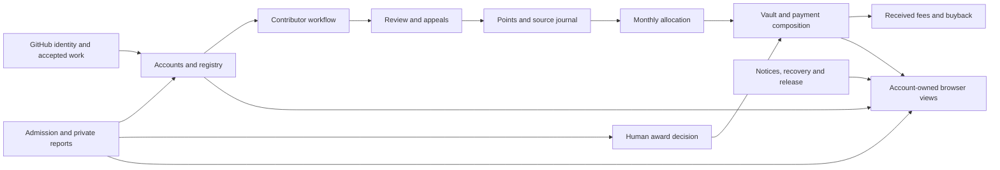

# Slop specification migration

The `vibestack` branch starts a new Git history from the Slop Vibestack template.
The initial commit carries that template, the pinned Slop requirements, formal
models and migration evidence. Git requires a commit before a branch can be
pushed. The old application remains on its existing branches.

## Sources

The source manifest pins every repository and commit. The requested `develop`
branch resolves to this repository's `development` integration branch. Its PRD
is byte-identical to the PRD at the matching `main` commit. The source manifest
records both current revisions and preserves the original requirements pin.
The PRD snapshot and Slop contribution and agent policies remain under `docs/`.

The user's 13 November 2026 decision overrides one sentence of the source PRD.
New project drafts start with automatic closure unchecked. Missing saved
consent is false. Existing project consent stays as recorded.

Current policy includes November's repository-append flow, line-weighted
implementation Points, the separate contributor allocation, buyback rules,
referral reactivation conditions, custom referral links, public referred
projects, provisional EVM vault funding and manual release coverage options.
Earlier snapshots remain in the original project history.

## Vibestack tooling

`vibestack/`, `SPEC.md`, the agent skills and the root engineering
configuration are vendored from the published `lalalune/vibestack` `develop`
commit `24160dee4adc6e6e074ab0039b01a101b059e857`. Only commits published there
are vendored. The readiness audit compared Slop `development` at
`87a26cc9844d04709e851686609c86f853e11678`, whose PRD has SHA-256
`8d62e02c652df461631512e39cb00a2079bcadcc19d75f51799fc047e69cbfd5`. The
retained PRD snapshot and source manifest keep their recorded pin until the
requirements catalog is repinned.

These local patches differ from that commit:

| Patch | Files | Reason |
| --- | --- | --- |
| Guide and license | `vibestack/README.md`, `vibestack/LICENSE` | The upstream README with links rebased to `../`; the root README describes Slop |
| `info` color, exported contrast and focus-ring boundary | `vibestack/design/tokens.ts`, `vibestack/design/test/`, root `package.json` export `./design/tokens` | Slop's tokens define `info`, which upstream rejects as an unknown token path; `ring` is held to 3:1 beside `input`; `@repo/ui` tests its colors with the token contrast function |
| Workspace packages | `pnpm-workspace.yaml`, `eslint.config.js`, `knip.config.js` | The catalog adds the component, icon and font dependencies of `packages/ui` and `packages/design-system`; directories without a `package.json`, such as `packages/contracts`, are no workspace package; Foundry is installed beside Node |
| Task graph | `turbo.json` | `@repo/ui#gen` waits for the root `gen` that writes the request states its stories read, which a fresh install otherwise races; `@repo/contracts` tasks; `//#formal:check` |
| Branches and package links | `.github/workflows/ci.yml`, `.github/workflows/fuzz.yml`, `package.json` | CI runs on `vibestack`, `development` and `main`, and the nightly fuzz run targets `vibestack`; the root package keeps the name `vibestack`, which the tools and workspace packages import, and drops upstream's repository, homepage and bug links |

`AGENTS.md` adds only the Slop specification migration section, which names
`lucide-react` as the single icon library and keeps pull-request narratives
true to their diff. `.github/workflows/release.yml` is not vendored.

## Ownership

| Area | Specification | Eventual shell boundary |
| --- | --- | --- |
| Browser | `spec/frontend/` | React, routes, accessible controls, account-owned requests and session storage |
| Accounts and registry | `spec/backend/` | GitHub authentication, D1 transactions, immutable identity, wallet signatures |
| Contribution | `spec/contributor/` | Canonical template rendering, filesystem installation, agent-client workflow, optional upload |
| Slopbot | `spec/slopbot/` | GitHub webhooks, provider calls, sandbox execution, labels and qualified closure |
| Points | `spec/points/` | GitHub collection, immutable source evidence, journal and projection publication |
| Security | `spec/security/` | Repository acquisition, private R2, D1 case transactions, current role checks |
| Settlement | `spec/settlement/` | Owner wallets, chain RPC, exact finalized evidence, scheduled reconciliation |
| Received fees | `spec/fees/` | Narrow fee-wallet signer, quote inspection, journal, bridge and swap reconciliation |
| Operations | `spec/operations/` | Inbox, delivery provider, backups, release and environment isolation |
| Composition | `spec/composition.md` | Account changes across browser children |

All product specs live in the single root tree. These areas are domain
ownership boundaries, with no new application packages introduced yet. When
implementation starts, a matching `apps/<name>` or `packages/<name>` owns that
area under Vibestack's normal generation rules. Cross-area rules use imports
and composed machines, and the generated core owns product state.

The template application remains its original greeting demonstration. Its
tests and drivers exercise the toolchain. The migration adds no Slop runtime,
database migration, route, signer, deployment or transaction.

## Coverage records

`formal/requirements.json` retains every PRD subsection's complete source text,
line range and owning spec paths. `formal/model-map.json` inventories every
legacy model, source mapping, action, scenario and digest, with its destination
area. `reference/slop-main/formal/` preserves the original models and inventories.
`reference/slop-main-delta/` retains six later legacy model inputs with separate
verification and successor mappings.

A mapped source establishes traceability. Equivalence requires a reviewed
transition-by-transition comparison or refinement proof. Legacy scenarios must
also run through the new entry points once the shell exists. The model map
keeps this obligation visible for every original model.

The active specs describe external observations through explicit parameters.
Their eventual adapters must verify identity, authority, signatures, exact
bytes, current revisions and finality before producing those events. Formal
proofs of those parameters' consequences do not verify the external facts.

The generated event decoder checks structure and invariants. The trusted shell
authenticates the sender and obtains authorization and evidence facts from
their owning services. Fields such as `moderator`, `freshAuthority`,
`receiptMatches` and `finalized` must be computed from those verified records.
A request body cannot assert them on the caller's own behalf. Each eventual
adapter journey must include a forged-fact request and a role-revocation race.

## Verification and acceptance

Use Node 26, the pinned pnpm workspace and Dafny 4.11. Run `pnpm install` and
`pnpm check`. The check parses and typechecks Quint, explores invariant and
reachability traces, replays the generated core, proves obligations, checks
types and runs existing journeys. The review stage retains new rules for
human sign-off. A full toolchain run uses `pnpm verify`, which includes
`pnpm formal:check`. That check fails when a spec has no catalog entry or
requirement owner, a recorded path or digest is stale, a requirement owner
names no story or rule heading of its spec's catalog entry, or a legacy model
has neither a candidate successor naming one of its actions nor a recorded
`noSuccessor` reason. Each requirement owner is
`{ "spec": <path>, "rules": [<heading>] }`. The actions `init` and `step`,
which every module has, do not identify a successor.

The source PRD's former `bun run formal:check` and `bun run formal:verify`
commands describe the old application's toolchain. This branch uses the
Vibestack commands above. The original Quint models are also checked directly
with the pinned Quint version, with commands and outcomes recorded separately.

Before accepting the specification, review each rule's prose and Quint, source
mapping, external assumption and verification result. The user runs
`pnpm accept` after that review. No proof exception is authorized by this
migration request.

## Implementation acceptance contract

Each future journey exercises its real entry points and matches the exact
reviewed source revision. Persisted data and untrusted events enter through
the generated decoders. An implementation that stores model state itself
needs a conformance driver importing the generated core as types only.

| Journey | Required real evidence |
| --- | --- |
| GitHub sign-in and account changes | Rename-stable identity, consent, return path, expiry, revocation, closure and cross-account cache isolation |
| Wallet registration and recovery | Account proof and wallet signature, immediate activation, retained first proof, replay, uncertain binding and successor private-payment requests |
| Project setup and removal | Current GitHub authority, license, installation, all-repository clearance, D1 revision conflicts, cancelled application and retained obligations |
| Skill install and contribution | Exact canonical commit and tree, approved digest, atomic activation, competing installers, rollback, offline local verification and live work selection |
| Agent-client use | Claude Code, Codex and ChatGPT, Hermes, OpenClaw, Muse, Grok, elizaOS and affected additional clients, each with exact client version, provider and model |
| Slopbot | Real provider routing and failure, exact source, incomplete review, policy opt-outs, qualified real closure cases and counterexamples, reopen, seven-day labels and appeal escalation |
| Points | Complete 35-day sources, immutable identity, retained copies, merge deduplication, line-weighted shares, review bands, historical corrections and funded-history preservation |
| Admission and flags | One verified shallow acquisition, complete review batches, durable evidence, no size refusal, two eligible flags, exemption revocation and fresh all-repository reinstatement |
| Private report | Exact retained bytes, idempotent R2/D1 completion, interrupted submission, current-role reads with audit, separate screening and human decisions, authorized forwarding and distinct receipt |
| Private award | Receipt-time terms, first qualifying finding, exact split, approved funding, partial legs, renewed wallet consent, retired old requests and separate disclosure approval |
| Monthly allocation | Frozen complete month, one proposal, adjustment and cutoff race, whole-allocation funding, walletless reserve, opt-out, replay and recipient isolation |
| Chain settlement | Supported asset/program, exact vault and recipient, amount and fee, independent finality, wrong asset and owner refusal, uncertain attempts, reorg and duplicate recovery |
| Fee handling and buyback | Inspected accounts/instructions, gas and value reservation, replacement, independent Solana expiry evidence, one bridge order, fulfilled/refunded finality, purchase and once-only burn |
| Notifications and recovery | Current destination and role, exact consent version, saved notice, read and acknowledgement, provider acceptance, actual receipt, retries, escalation and restored backups |
| Interface | Desktop, mobile, keyboard, screen reader, WCAG AA, 200% zoom, reduced motion, visible amounts and consent, links, downloads, console and first-party network behavior |
| Release | Isolated staging, trusted main release, exact tested bytes, publication lock, registry/data provenance, DNS, TLS, redirects, headers and independently gated activation |

Real model behavior uses real providers. Database races use the real database.
Chain effects use the approved network and financial scope. Provider, browser,
database, chain and deployment acceptance follow implementation. Existing
approved waivers remain recorded as waivers. STATE-01 through STATE-05 remain
open until the required source mappings and implementation evidence are complete.
